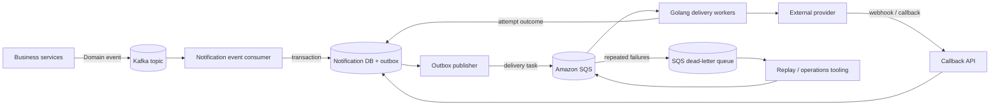
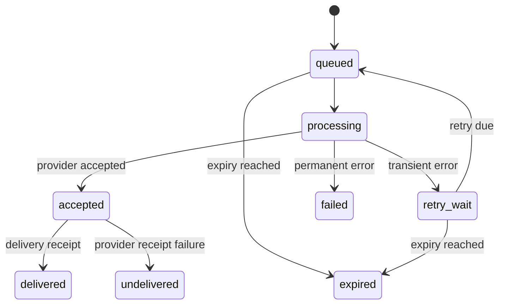

# Event-Driven Notification Delivery Service

**Author:** Ankit Yadav  
**Document type:** Independent system-design portfolio sample  
**Status:** Proposed architecture

> This repository presents a reference design for a notification delivery platform. It is an independent portfolio exercise, not a description of any employer's confidential production system. Capacity figures, SLAs, and vendor limits must be validated against real workload data before implementation.

## 1. Problem statement

A product platform needs to send notifications (for example, WhatsApp, email, or SMS) after business events such as an order update, payment confirmation, or account alert. The system should absorb traffic spikes, isolate business APIs from slow third-party providers, retry transient failures safely, and expose delivery status.

The design separates **business-event distribution** from **notification-delivery work**:

- **Kafka** carries domain events and supports independent downstream consumer groups and replay.
- **Amazon SQS** buffers individual delivery tasks and distributes work to horizontally scaled workers.
- **Golang workers** call external providers and persist delivery outcomes.

Using both Kafka and SQS is a deliberate option, not a requirement. If notification delivery is the only asynchronous consumer, an SQS-only design may be simpler (see [ADR 001](docs/decisions/001-kafka-and-sqs.md)).

## 2. Goals and non-goals

### Goals
- Keep notification work off synchronous business request paths.
- Support multiple event producers and notification channels.
- Handle bursts with durable buffering and controlled concurrency.
- Provide bounded retries, dead-letter handling, and operational replay.
- Prevent duplicate user-visible sends as far as provider capabilities allow.
- Track accepted, queued, attempted, sent, delivered, and failed states.
- Protect personal data and make operations observable.

### Non-goals
- Guarantee exactly-once delivery across our database, queue, network, and an external provider. That guarantee is generally unavailable end-to-end.
- Define provider-specific contracts or commercial SLAs.
- Implement campaign management, audience segmentation, or a template authoring UI.
- Treat a provider's HTTP 200 response as proof that a handset received a message.

## 3. High-level architecture

### Component responsibilities

| Component | Responsibility |
|---|---|
| Business services | Publish domain facts; do not call providers directly |
| Kafka | Retain and distribute domain events to independent consumer groups |
| Event consumer | Validate event, resolve preferences/templates, create notification intent |
| Notification DB | Store intent, status, idempotency key, attempts, provider reference |
| Transactional outbox | Atomically record work that must later be published to SQS |
| SQS | Buffer delivery tasks and apply backpressure |
| Delivery workers | Enforce rate limits, call providers, classify errors, persist attempts |
| Provider callback API | Authenticate and reconcile asynchronous delivery receipts |
| DLQ + replay tooling | Isolate poison messages and support controlled recovery |

## 4. End-to-end flow

1. A business service commits its own business change and publishes a domain event to Kafka. The producer uses an outbox if losing an event between its database commit and Kafka publish is unacceptable.
2. The notification consumer reads the event and validates its schema and required fields.
3. It calculates an idempotency key and transactionally creates a notification record plus an outbox record. A uniqueness constraint prevents repeated processing of the same logical notification.
4. An outbox publisher sends a delivery task to SQS. It marks the outbox row published only after SQS acknowledges the send. A crash can cause a duplicate task, so workers must remain idempotent.
5. A worker receives a task, checks current notification state, preferences, expiry, and provider rate limits, then attempts delivery.
6. On a definitive provider acceptance, the worker records the provider message ID and an accepted/sent state. A later callback can move it to delivered, undelivered, or failed.
7. Transient failures are retried with bounded exponential backoff and jitter. Permanent failures are recorded and acknowledged. Repeated failures move to the DLQ according to queue redrive policy.
8. Operators inspect DLQ reason and age, correct the underlying issue, and replay only eligible messages.

## 5. Event and task contracts

Contracts are versioned. Consumers should tolerate additive optional fields and reject unsupported breaking changes.

### Example business event

See [examples/business-event.json](examples/business-event.json).

Required conceptual fields:
- `event_id`: globally unique event identifier.
- `event_type`: stable domain event name.
- `occurred_at`: UTC timestamp.
- `schema_version`: contract version.
- `aggregate_id`: business entity identifier.
- `data`: minimal event payload; avoid unnecessary personal data.

### Example delivery task

See [examples/notification-task.json](examples/notification-task.json).

The task should contain a notification ID, channel, template reference, recipient reference, locale, expiry, and correlation metadata. Prefer references to sensitive recipient data over embedding raw phone numbers or email addresses in queue messages.

## 6. Persistence model

A relational store such as PostgreSQL or MySQL is a reasonable starting point.

### notifications
- `id` (primary key)
- `source_event_id`
- `idempotency_key` (unique)
- `recipient_ref`
- `channel`
- `template_id`, `template_version`
- `status`
- `provider_message_id` (nullable, indexed)
- `expires_at`
- `created_at`, `updated_at`

### delivery_attempts
- `id` (primary key)
- `notification_id` (foreign key)
- `attempt_number`
- `provider`
- `request_id` (redacted / non-sensitive)
- `outcome`
- `error_class`, `error_code`
- `started_at`, `finished_at`

### outbox
- `id` (primary key)
- `aggregate_id`
- `event_type`
- `payload`
- `created_at`
- `published_at` (nullable)
- `publish_attempts`

Useful indexes include the unique idempotency key, notification status plus creation time, provider message ID, and unpublished outbox rows. Partitioning and retention should be driven by observed volume and compliance requirements rather than assumed up front.

## 7. State model

A practical state model distinguishes provider acceptance from final delivery:

State transitions should be guarded by conditional updates/version checks so late callbacks cannot overwrite a newer terminal state. Store provider callback event IDs to deduplicate repeated webhooks.

## 8. Reliability and delivery semantics

### At-least-once processing
Kafka consumers and SQS workers can receive a message more than once. The design therefore assumes at-least-once processing and makes each stage idempotent:
- Unique `(source_event_id, notification purpose, recipient, channel)` or a deterministic idempotency key.
- Conditional state transition before sending.
- Provider idempotency key when supported.
- Persist provider references and reconcile ambiguous outcomes.
- Deduplicate callbacks by provider event ID.

### The ambiguous timeout problem
If a provider accepts a message but the network times out before the worker receives the response, blindly retrying may send a duplicate. Prefer a provider idempotency key or status lookup using a client reference. If neither exists, record the attempt as **unknown**, reconcile where possible, and make the residual duplicate risk explicit.

### Retry policy
- Retry only transient errors (timeouts, throttling, selected 5xx responses).
- Do not retry invalid recipients, malformed payloads, or unsupported templates without correction.
- Use exponential backoff with full jitter and a maximum delay.
- Respect provider `Retry-After` guidance.
- Set a maximum attempt count and an absolute notification expiry.
- Keep retry policy channel/provider-specific and configurable.

### SQS visibility and DLQ
Set visibility timeout longer than normal processing duration, with extension/heartbeat for longer calls. Configure a redrive policy with a maximum receive count based on measured behavior. Alert on DLQ depth and oldest-message age. A DLQ is a quarantine, not a retry strategy by itself.

## 9. Scaling and backpressure

- Scale workers based on queue depth, oldest-message age, and sustainable provider throughput—not CPU alone.
- Apply per-provider and per-tenant token-bucket limits to avoid provider throttling.
- Bound worker concurrency and HTTP connection pools.
- Use circuit breakers for sustained provider outages; avoid hot-loop retries.
- Prioritize time-sensitive notifications only if the product requires it; separate queues can prevent low-priority bulk traffic starving critical alerts.
- Scale Kafka partitions and consumer instances based on throughput and ordering requirements. Ordering is only guaranteed within a partition.
- Keep database writes batched where safe, but do not weaken state correctness for throughput.

## 10. Observability

### Metrics
- Events consumed / lag by Kafka consumer group.
- Outbox backlog and oldest unpublished row age.
- SQS visible, in-flight, delayed, and DLQ message counts.
- Queue age and end-to-end notification latency (p50/p95/p99).
- Provider request rate, latency, throttles, timeouts, and error classes.
- Success, delivered, undelivered, expired, and duplicate-suppression rates.
- Retry attempts per notification.

### Logs and traces
Propagate `correlation_id`, `event_id`, `notification_id`, and attempt number across services. Use structured logs. Never log message bodies, access tokens, full phone numbers, or email addresses. Trace asynchronous boundaries with trace context carried in message attributes.

### Alerts
Alert on growing consumer lag, stuck outbox records, queue age exceeding product objectives, provider error spikes, DLQ growth, and callback processing failures.

## 11. Security and privacy

- Encrypt data in transit and at rest; use managed key services and rotation.
- Grant least-privilege IAM permissions to producers, publishers, workers, and operators.
- Store provider credentials in a secrets manager, never in source control or queue payloads.
- Minimize personal data in Kafka and SQS messages; use tokenized recipient references where practical.
- Redact logs and define retention/deletion policies for payloads and delivery metadata.
- Authenticate and verify provider callbacks (signature, timestamp, replay protection).
- Audit manual replay and access to recipient data.

## 12. Testing strategy

| Test level | What to verify |
|---|---|
| Unit | Retry classification, idempotency key, state transitions, template resolution |
| Contract | Producer/consumer schema compatibility and provider adapter contracts |
| Integration | DB transaction + outbox, Kafka consumption, SQS publishing/consumption |
| Fault injection | Worker crash, duplicate delivery task, timeout after provider acceptance, callback duplication |
| Load | Burst traffic, provider throttling, DB contention, queue drain time |
| Recovery | DLQ inspection, replay safety, provider outage recovery |

A key acceptance test: deliver the same business event multiple times and verify that the system creates one logical notification and suppresses duplicate send attempts wherever the provider contract permits.

## 13. Rollout plan

1. Start with one channel and one provider; define explicit delivery states and metrics.
2. Introduce schema validation, idempotency constraints, and the transactional outbox.
3. Load-test queue sizing, worker concurrency, and provider quotas.
4. Release behind a feature flag to a small tenant/cohort.
5. Compare delivery latency, error rate, and duplicate rate with the existing path.
6. Expand gradually; document rollback and DLQ replay ownership.
7. Add further channels/providers through adapters and versioned templates.

## 14. Key trade-offs and open questions

- **Kafka + SQS vs SQS only:** use both when event-stream fan-out/replay and a separate task queue are meaningful requirements. Prefer SQS only for a single asynchronous delivery workflow to reduce operational complexity.
- **Database choice:** relational storage gives useful uniqueness and transactional guarantees; high-volume partitioning and retention need workload validation.
- **Ordering:** decide whether notifications for one aggregate must be ordered. If yes, define partition/group keys and worker concurrency constraints.
- **Provider abstraction:** a common adapter interface improves portability, but provider-specific capabilities (idempotency, receipts, templates, rate limits) must remain visible.
- **Delivery objective:** define whether the product cares about provider acceptance or final handset delivery, and set latency/availability objectives accordingly.
- **Multi-region:** introduce only after defining data residency, failover ownership, duplicate suppression across regions, and provider routing.

## 15. Further reading in this repository

- [Architecture decision record: Kafka and SQS](docs/decisions/001-kafka-and-sqs.md)
- [Retry and DLQ operations runbook](docs/operations/retry-and-dlq-runbook.md)
- [Architecture diagram source](diagrams/architecture.mmd)
- [Business event example](examples/business-event.json)
- [Notification task example](examples/notification-task.json)

---

*This design is intended to invite engineering discussion. Production implementation requires workload sizing, provider-specific failure semantics, security review, and explicit SLOs.*
